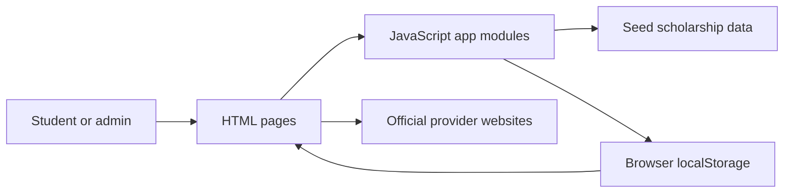

<div align="center">

# ScholarPath

### Scholarship discovery and application organizer for students in India

Explore scholarship listings, compare profile-based eligibility, and keep application progress organized in one responsive web app.

<br>


</div>

---

## About

**ScholarPath** is an academic front-end prototype that brings scholarship discovery and personal application organization together. Students can browse a seeded catalog, narrow listings by eligibility-related criteria, save opportunities, and keep a local record of application progress.

The project is built with semantic HTML, CSS, and vanilla JavaScript. It does not require a package installation, build pipeline, backend, or external database.

> **Important:** ScholarPath is an educational demo, not a government service or official eligibility authority. Applications are not submitted to scholarship providers from this site. Always confirm current deadlines, eligibility rules, and application steps on the official scheme portal.

## At a glance

| | |
|---|---|
| **Application type** | Static, browser-based web app |
| **Audience** | Students exploring scholarships in India |
| **Catalog** | 16 seeded scholarship records |
| **Persistence** | Browser `localStorage` |
| **Build / install** | None |
| **Current sample data** | The bundled deadlines have passed; listings are shown as closed and their official links remain available for checking future cycles. |

## Contents

- [Features](#features)
- [How it works](#how-it-works)
- [Technology](#technology)
- [Project structure](#project-structure)
- [Run locally](#run-locally)
- [Demo accounts](#demo-accounts)
- [Data, privacy, and limitations](#data-privacy-and-limitations)
- [Maintaining the catalog](#maintaining-the-catalog)
- [Academic project](#academic-project)

## Features

### Scholarship discovery

- Search by scholarship name, provider, or keyword.
- Filter by category, CGPA, income limit, course, deadline, and award amount.
- Sort the catalog and switch between grid and list layouts.
- Save and revisit scholarships from the student profile.
- Review eligibility details and continue to the listed official provider website.
- Expired opportunities are marked closed instead of being presented as open.

### Student experience

- Multi-step registration with client-side validation.
- Student sign-in, profile, dashboard, and scholarship recommendations.
- Profile-based match scores intended as a discovery aid—not a guarantee of eligibility.
- Guided application form with drafts, local document previews, and a personal status tracker.
- Light and dark themes with responsive layouts for mobile and desktop.

### Admin demonstration

- Scholarship and application management screens.
- Demo review/status workflow and summary analytics.
- Role-based page routing for the seeded demo accounts.

## How it works



Scholarship and demo account data are loaded by the browser. User profiles, bookmarks, drafts, and application records are stored locally in that browser; they are not synchronized to a server.

## Technology

| Layer | Implementation |
|---|---|
| Markup | Semantic HTML5 |
| Styling | CSS custom properties, Grid, Flexbox, and responsive media queries |
| Application logic | Vanilla JavaScript (ES6+) |
| Persistence | Browser `localStorage` |
| Visualizations | Native Canvas 2D |
| Icons | Inline SVG |
| Fonts | Inter and Poppins via Google Fonts |

## Project structure

```text
ScholarPath/
├── index.html               # Public landing page
├── register.html            # Multi-step registration
├── login.html               # Sign-in and demo account shortcuts
├── dashboard.html           # Student profile and recommendations
├── scholarships.html        # Searchable scholarship catalog
├── apply.html               # Guided application organizer
├── track.html               # Personal application status tracker
├── admin.html               # Admin demo and analytics
├── css/
│   └── style.css            # Shared theme, components, and responsive layouts
└── js/
    ├── data.js              # Seed scholarship and demo account data
    ├── storage.js           # localStorage access and demo records
    ├── auth.js              # Client-side demo authentication and validation
    ├── ui.js                # Shared UI helpers, themes, and recommendations
    ├── scholarships.js      # Catalog search, filtering, sorting, and details
    ├── apply.js             # Application form and local draft handling
    └── admin.js             # Admin demo workflows and analytics
```

## Run locally

No dependencies or build step are needed. From the project directory, start a local static server:

```powershell
py -m http.server 8000
```

Then open **http://localhost:8000** in a browser. If the Python launcher is unavailable, use `python -m http.server 8000`.

Stop the server with `Ctrl+C`.

## Demo accounts

| Role | Email | Password |
|---|---|---|
| Student | `arjun@student.com` | `Student@123` |
| Admin / nodal officer | `admin@scholarpath.in` | `Admin@123` |

The login page also provides demo sign-in shortcuts. These credentials are included for demonstration only; do not reuse them for real accounts.

## Data, privacy, and limitations

- **No live provider integration:** The catalog is seeded in `js/data.js`; it does not fetch current listings from government or provider APIs.
- **Verify before applying:** Scholarship details can change. Confirm dates, award amounts, eligibility, and application instructions with the official provider.
- **No online submission:** The application form organizes demo information locally; it does not submit an application to an external scholarship portal.
- **Local-only records:** Profiles, bookmarks, and application progress use `localStorage` on the current browser and device. Clearing browser data removes them.
- **Document previews stay in the browser:** The demo previews selected files locally; it does not upload documents to a server.
- **Prototype authentication:** Authentication and authorization run in client-side JavaScript, and demo password values are not protected by a production-grade server-side system. Do not enter real passwords, identity documents, or bank details.

## Maintaining the catalog

Scholarship records are defined in `js/data.js`. When updating an entry, verify its current information against the official provider and review:

- deadline and whether applications are actually open;
- award amount and payment period;
- eligible courses, categories, locations, and academic requirements;
- official application URL.

The app uses the listed deadline to determine whether an application action should be available. Do not extend or invent deadlines to make a listing appear open.

## Academic project

Developed as a B.Tech Computer Science & Engineering project at **Dayananda Sagar University (DSU), Bengaluru**.

**Team:** Syed Fazil · Tejas C · Puneeth Kumar
